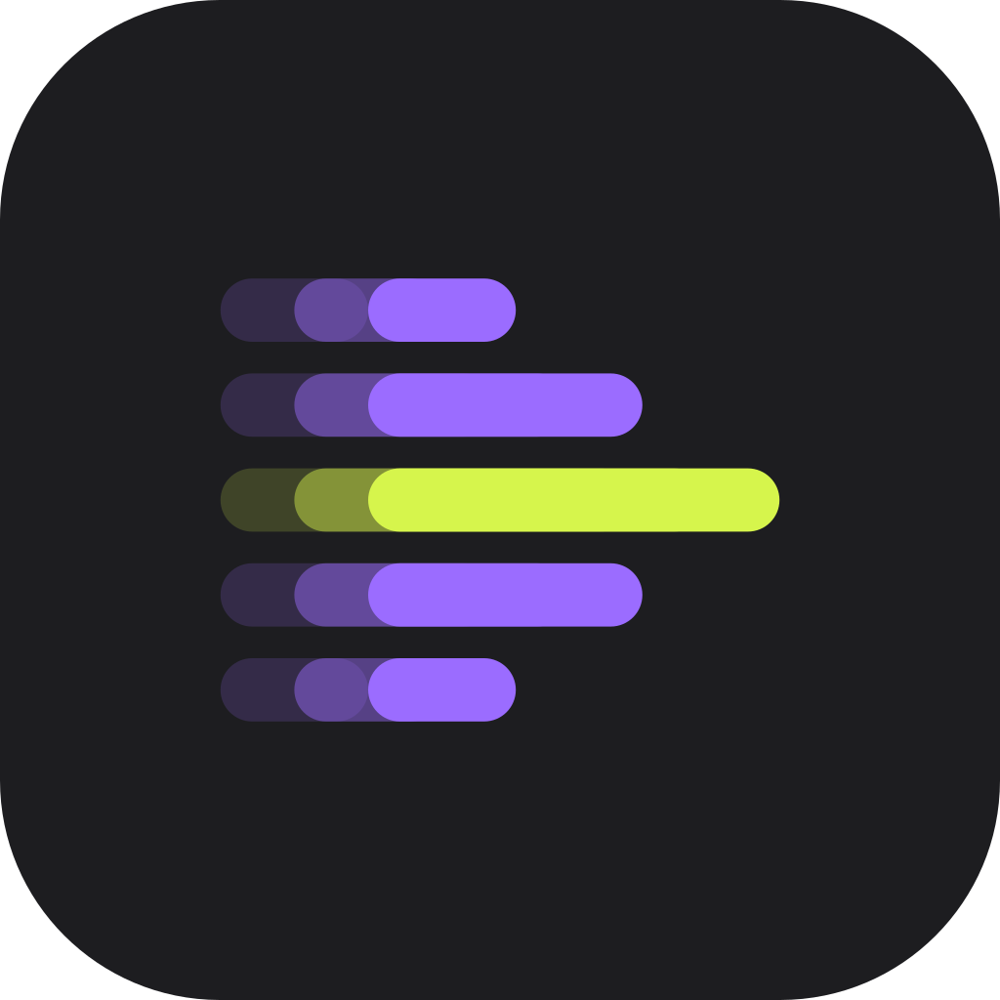
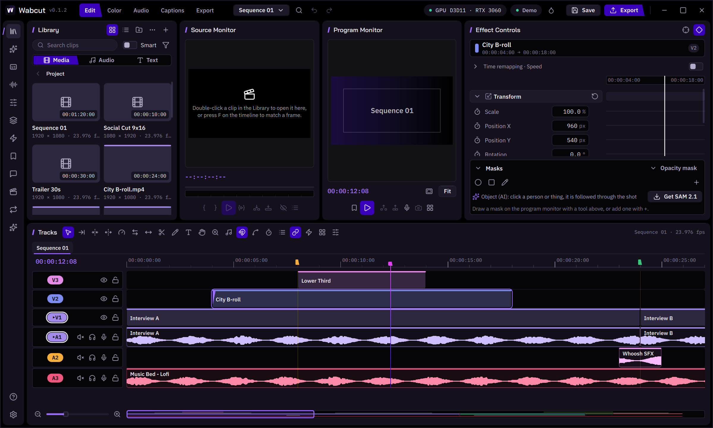
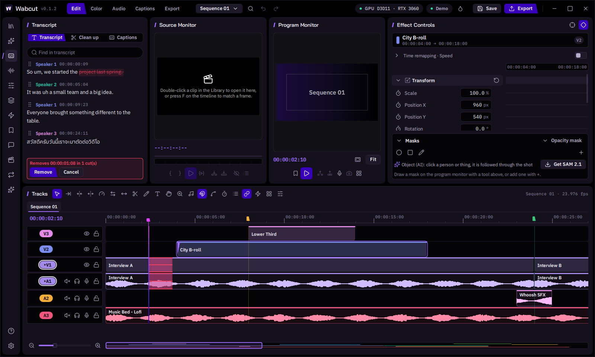
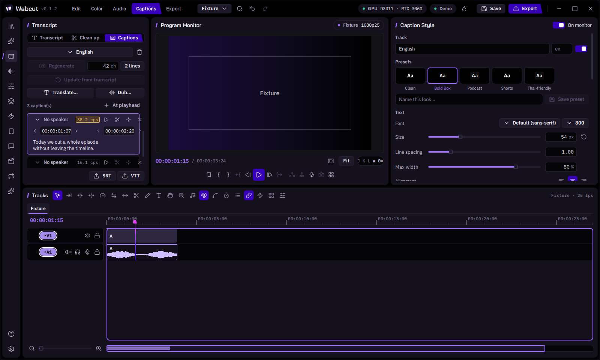
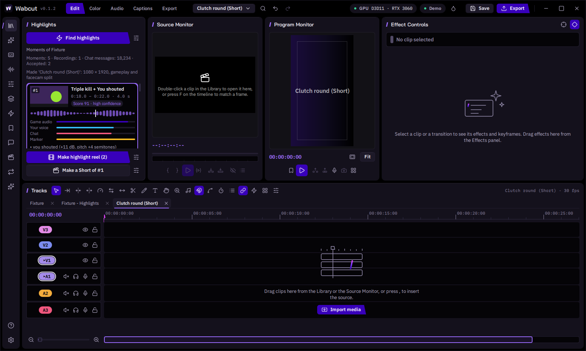
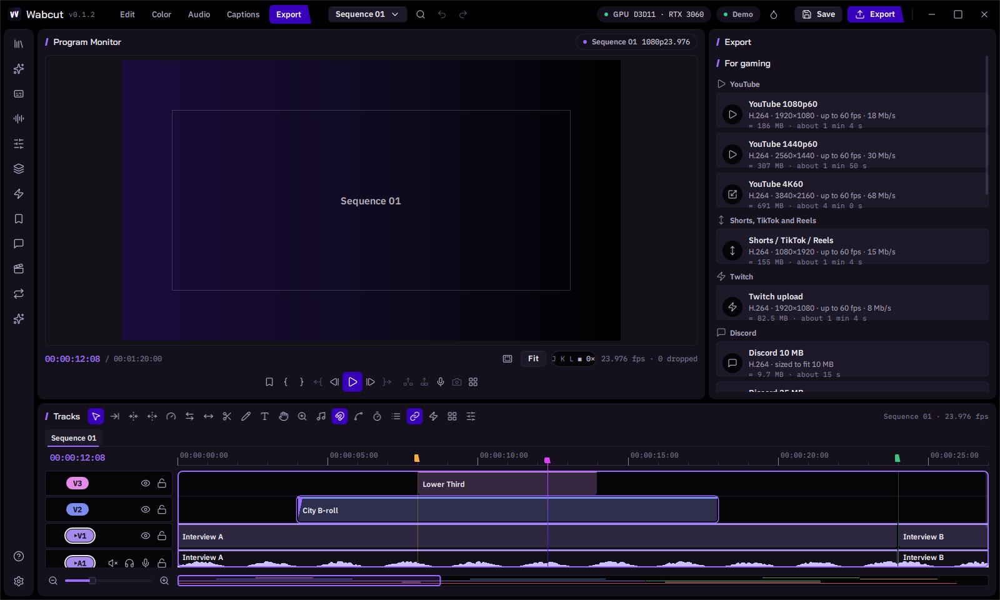
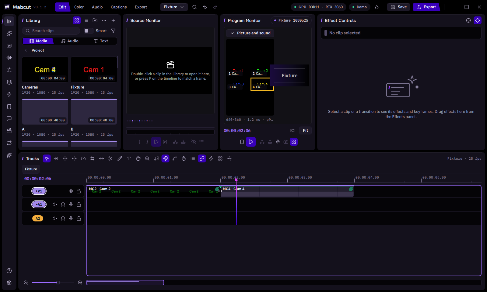
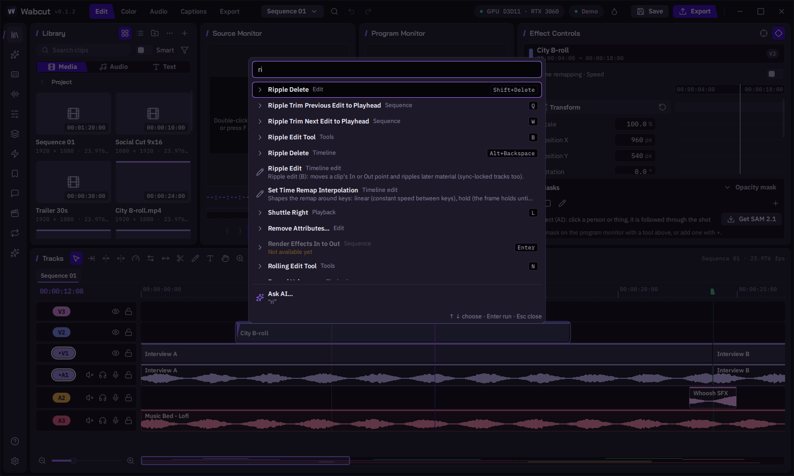

<div align="center">



# Wabcut

**A free, open-source video editor for gaming videos, video essays and documentaries.**

Premiere Pro's shortcuts and edit rules · round trips with Premiere, Resolve and Final Cut · AI that runs on your own machine

[](#project-status)
[](docs/release-notes-0.1.md)
[](#install)
[](LICENSE)
[](docs/building.md)
[](docs/building.md)

[**Download**](../../releases/latest) · [**Getting started**](docs/getting-started.md) ·
[**Roadmap**](#roadmap) · [**Documentation**](#documentation) · [**Build from source**](#building-from-source)

</div>

> [!WARNING]
> **Wabcut is in development. This is an alpha version (0.1.2).**
> Expect bugs, missing features and changes between versions, including to shortcuts, settings and the project format.
> Keep backups of your projects and media, and don't rely on it yet for deadline work or sensitive material.



## Why Wabcut

- **Edit like Premiere.** Premiere Pro's default shortcuts and tools, `.kys` shortcut import and a Keyboard Trainer, so
  your muscle memory carries over.
- **Bring your edit with you.** Import timelines from Premiere Pro, DaVinci Resolve and Final Cut Pro (FCP7 XML,
  FCPXML, OpenTimelineIO, EDL) and send them back the same way.
- **AI that stays yours.** Transcription, speech enhancement, smart search and object masks run locally. Cloud features
  use your own API keys and show the cost before every call.
- **Free and open source.** GPL-licensed, with no account and no subscription.

## Features

<table>
  <tr>
    <td width="50%" valign="top">
      
      <br><b>Edit by text.</b> Strike words in the transcript and the cut lands on the timeline, through multicam
      clips too. Thai is supported.
    </td>
    <td width="50%" valign="top">
      
      <br><b>Animated captions.</b> Style presets (Clean, Bold Box, Shorts, Thai-friendly), translation, dubbing and
      SRT/VTT export.
    </td>
  </tr>
  <tr>
    <td width="50%" valign="top">
      
      <br><b>Highlight finder.</b> Ranks moments in a game recording by game audio, your voice, chat and markers, then
      builds a highlight reel or a vertical Short.
    </td>
    <td width="50%" valign="top">
      
      <br><b>Export presets for creators.</b> YouTube up to 4K60, Shorts/TikTok/Reels, Twitch, and Discord presets
      sized to fit the upload limit.
    </td>
  </tr>
  <tr>
    <td width="50%" valign="top">
      
      <br><b>Multicam.</b> Angles synced by audio, switched from a grid in the program monitor.
    </td>
    <td width="50%" valign="top">
      
      <br><b>Command palette.</b> Every command with its shortcut, one keystroke away, plus "Ask AI".
    </td>
  </tr>
</table>

<sub>Screenshots: Wabcut 0.1.2 with its built-in demo project, captured by the automated UI tests.</sub>

### Who it is for

- **Gaming creators.** Turn OBS, ShadowPlay and Xbox Game Bar recordings into YouTube videos, highlight reels and
  vertical Shorts/TikToks:
  - named tracks for game, mic and Discord audio;
  - 60–240 fps and variable frame rate;
  - a highlight finder, instant replay and punch-in zoom;
  - facecam layouts and 12 built-in gaming templates;
  - YouTube, Twitch, Shorts and Discord-size export presets.
- **Video essayists.** Voice-over recording, transcripts, text-based editing, animated captions, titles, and music with
  auto-ducking and loudness targets.
- **Documentary editors.** Multicam synced by audio, editing by text, colour with scopes, privacy redaction that follows
  the footage, and timeline round trips with Premiere and Resolve.

## Project status

Wabcut is an **alpha**. The current release is **0.1.2 "First Cut"**. Most of the editor works, but it has only been
tested on a small number of machines and projects. Known gaps in this version:

- **Windows only, tested on Windows only.** Wabcut is built by a solo developer who works only on Windows 10 and 11,
  so macOS and Linux are untested. There are no builds for them yet; the repository's Linux and macOS CI jobs are
  experimental and nothing they report has been checked on a real machine.
- **Not code-signed and no auto-update.** Windows SmartScreen may warn on first run.
- **AI quality is not benchmarked yet.** Local models and live cloud providers have not been measured on real projects.
- **Not built yet:** HDR grading (game captures in HDR are tone-mapped to SDR), Optical Flow slow motion, OpenFX
  video plug-ins and cloud collaboration.
- **Privacy redaction:** check every redacted export by eye before you share it.

The full list is in the [release notes](docs/release-notes-0.1.md#known-issues).

## Roadmap

Wabcut is built Windows-first for gaming videos, video essays and documentaries. This is a plan, not a promise: the
order will change as people use it. Details are in the [full roadmap](docs/roadmap.md).

- [x] **0.1 "First Cut"** (October 2026): the first alpha. Premiere-style editing, import and export with Premiere,
  Resolve and Final Cut, gaming tools, transcripts and captions, colour, and local or bring-your-own-key AI.
- [ ] **Toward a beta:** fixes from real projects, code-signed installers and automatic updates, measured AI quality,
  and screen-reader checks.
- [ ] **Started, parked for after 0.1:** Content Credentials (C2PA) on export, ACES/OCIO colour management with HDR
  grading, and a warp stabilizer.
- [ ] **Wanted, not scheduled:** macOS and Linux builds, Optical Flow slow motion, OpenFX video plug-ins, AAF/OMF
  export, and caption file import.

**Not planned for now:** live co-editing, a plug-in marketplace, an After Effects-class compositor, and publishing
straight to social platforms.

Need something that isn't here? [Open an issue](../../issues) and say what you're trying to make.

## Install

**Requirements:** Windows 10 (22H2) or 11, x64, a DirectX 11 GPU and 16 GB of RAM (8 GB minimum).

1. Download the latest release from the [Releases page](../../releases/latest): a per-user **MSI** (no administrator
   rights needed) or a **portable ZIP**.
2. Run it. The packages are not code-signed yet, so SmartScreen may block the first run: choose **More info**, then
   **Run anyway**.
3. Follow **[Getting started](docs/getting-started.md)**. It walks through four example projects: a gaming video, a
   Short, a video essay and a documentary.

## Privacy and AI

Nothing leaves your computer unless you turn on a cloud feature with your own key:

- every cloud call shows its cost first;
- a project can be locked to "no cloud";
- keys are kept in the Windows credential store.

Local models (transcription, speech enhancement, stem separation, smart search, object masks) run on your GPU or CPU
after a one-time download. See [AI with your own key](docs/getting-started.md#ai-with-your-own-key) and [AI](docs/ai.md).

## Documentation

| For editors | For agents and scripts | For contributors |
|---|---|---|
| [Getting started](docs/getting-started.md) | [Commands](docs/commands.md): every edit as a typed, previewed, undoable command | [Building](docs/building.md) |
| [Keymap](docs/keymap.md): Premiere shortcuts, `.kys` import | [MCP](docs/mcp.md): `wabcut-cli mcp`, a local server for Claude, Codex and other agents | [Architecture](docs/architecture.md) |
| [Export](docs/export.md) | [Extensions](docs/extensions.md): add commands in JavaScript | [Design language](docs/design-language.md) and [design system](docs/design-system.md) |
| [Interchange](docs/interchange.md): Premiere, Resolve, Final Cut, OTIO, EDL | | [Performance](docs/performance.md) |
| [Graphics and templates](docs/graphics.md) | | [Release process](docs/release.md) |
| [Colour](docs/color.md) | | [Roadmap](docs/roadmap.md) |
| [Masks and redaction](docs/masks.md) | | |
| [Audio plug-ins](docs/plugins.md) | | |
| [Premiere Pro comparison](docs/premiere-parity.md) | | |

## Building from source

**Stack:** C++23 · Qt 6.11 Quick/QML · Qt RHI (Direct3D 11 on Windows) · FFmpeg 9 · miniaudio · whisper.cpp ·
ONNX Runtime · CMake + vcpkg.

Prerequisites are listed in [docs/building.md](docs/building.md). Quick start on Windows:

```powershell
. .\tools\dev-env.ps1            # VS dev shell + VCPKG_ROOT + Qt path (override via env vars)
cmake --preset win-msvc
cmake --build --preset win-msvc
ctest --preset win-msvc
.\build\win-msvc\bin\wabcut.exe
```

The Qt-free core (edit engine, commands, interchange and AI logic) is written to build on any OS, but like the rest
of Wabcut it is only tested on Windows:

```sh
cmake --preset core && cmake --build --preset core && ctest --preset core
```

## Contributing

Wabcut is early, so feedback is the most useful contribution right now.

- **Bugs and ideas:** open an [issue](../../issues). Include the Wabcut version (shown in the title bar), your Windows
  version and GPU, and the steps that reproduce the problem.
- **Other platforms:** reports from building or running Wabcut on macOS or Linux are welcome, since the solo developer
  can only test on Windows.
- **Code:** read [building](docs/building.md) and [architecture](docs/architecture.md) first. Keep each pull request
  focused on one change, and run `ctest --preset win-msvc` (or the `core` preset) before you open it.

## License

Wabcut is licensed under **GPL-3.0-or-later** (see [LICENSE](LICENSE)). Third-party notices are in
[THIRD-PARTY-NOTICES.md](THIRD-PARTY-NOTICES.md) and are installed with the app.

The GPL lets builds include x264/x265 for high-quality software encoding. Codec patent licensing (H.264/HEVC/AAC) is
separate from copyright and is your responsibility when you distribute binaries.
